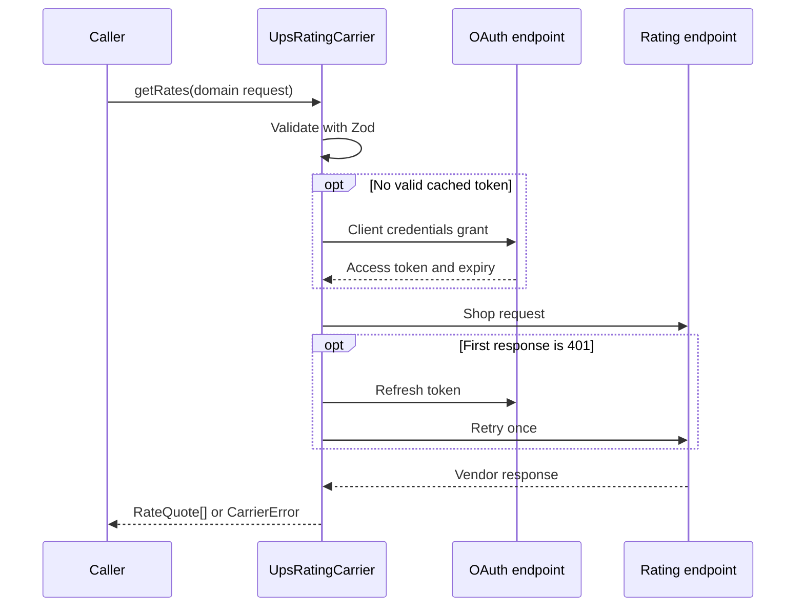

# Carrier rating, behind one interface

A TypeScript UPS rating adapter that accepts a carrier-neutral shipment, validates it with Zod, obtains an OAuth token, requests Shop rates, and returns normalized quotes. Callers handle typed errors rather than parsing vendor messages.

The scope is intentionally narrow: **rating through one implemented carrier**. There is no label purchase, shipment booking, tracking service, HTTP server, or implemented FedEx adapter.

## Run it without carrier credentials

```sh
npm ci --ignore-scripts
npm test
npm run typecheck
npm run build
node examples/offline-rates.mjs
```

Node.js 18 or later supplies `fetch`, `Response`, and `AbortController`. The offline example injects fixture responses, makes no external request, and prints normalized quote objects. It uses invented addresses and nonfunctional credentials.

One quote from the checked-in fixture has this shape:

```json
{
  "carrierId": "ups",
  "serviceCode": "03",
  "serviceName": "Ground",
  "totalPrice": "12.34",
  "currencyCode": "USD",
  "billingWeight": "2"
}
```

That is a fixture value, not a current shipping price. `totalPrice` remains a string to preserve the carrier's decimal representation rather than introducing floating-point currency arithmetic.

## Request → adapter → quote



[`RatingCarrier`](src/rating-carrier.ts) defines the port. [`UpsRatingCarrier`](src/ups/carrier.ts) handles the integration. Pure [translation helpers](src/ups/helpers.ts) keep UPS request/response shapes separate from [domain schemas](src/schemas/domain.ts). The injectable fetch implementation lets tests exercise that complete adapter boundary without a network dependency.

## Use the exported factory

After building, import `createUpsRatingCarrierFromEnv` from `dist/index.js`, construct a carrier, and call `getRates(request)`. The full request is in [`examples/offline-rates.mjs`](examples/offline-rates.mjs). It includes origin and destination addresses, a shipper, and packages with positive weights and dimensions.

[`loadEnv`](src/env.ts) validates configuration when the environment-based factory is called; simply importing the module does not run a service or validate startup configuration. The library does not automatically load `.env`: your host process must populate its environment. [`.env.example`](.env.example) lists the expected variables.

| Configuration | Role |
| --- | --- |
| `UPS_API_BASE_URL`, `UPS_OAUTH_TOKEN_URL` | Explicit rating and OAuth endpoints |
| `UPS_CLIENT_ID`, `UPS_CLIENT_SECRET` | Credentials supplied by the host application |
| `UPS_ACCOUNT_NUMBER` | Optional account number used in request translation |
| `UPS_RATING_VERSION` | Rating API version string |
| `REQUEST_TIMEOUT_MS` | Abort timeout for each HTTP request |
| `TOKEN_SKEW_MS` | Refresh buffer before token expiry |

Use your own authorized test environment for live requests. Never commit real credentials or put tokens into URLs. Tests and the offline example do not validate live account permissions or a current UPS API contract.

## Failures are part of the interface

`CarrierError.kind` is one of `validation`, `auth`, `upstream`, `timeout`, or `parse`. Errors can also carry a code, HTTP status, details, and cause. A caller can branch on `kind` to show a useful message or choose its own recovery policy. Raw upstream details can contain operational or shipment information; redact them before public logging.

OAuth tokens are cached in memory on each adapter instance. A first rating 401 invalidates the cache and retries once; there is no unbounded retry loop. Concurrent cold calls can still fetch multiple tokens because refresh requests are not coalesced. General retry/backoff for 429/5xx responses and distributed token storage are not implemented.

## Verification and next extensions

The fixture-backed tests cover request translation, normalized quotes, token reuse/expiry, a single refresh-and-retry, invalid input, malformed JSON, upstream/auth errors, and timeouts. They are adapter integration tests with **stubbed HTTP**, not live UPS tests.

A second carrier would be a useful test of the port's boundaries. Before broadening scope, tighten vendor schema coverage, coalesce concurrent token refreshes, add response-body limits, and define a measured retry policy. Carrier-specific service semantics and real-world multi-package responses need more fixtures; array-shaped package input alone is not proof that every carrier scenario is supported.

No UI is part of this package. The sequence diagram and executable offline example are the most direct way to inspect its behavior.
